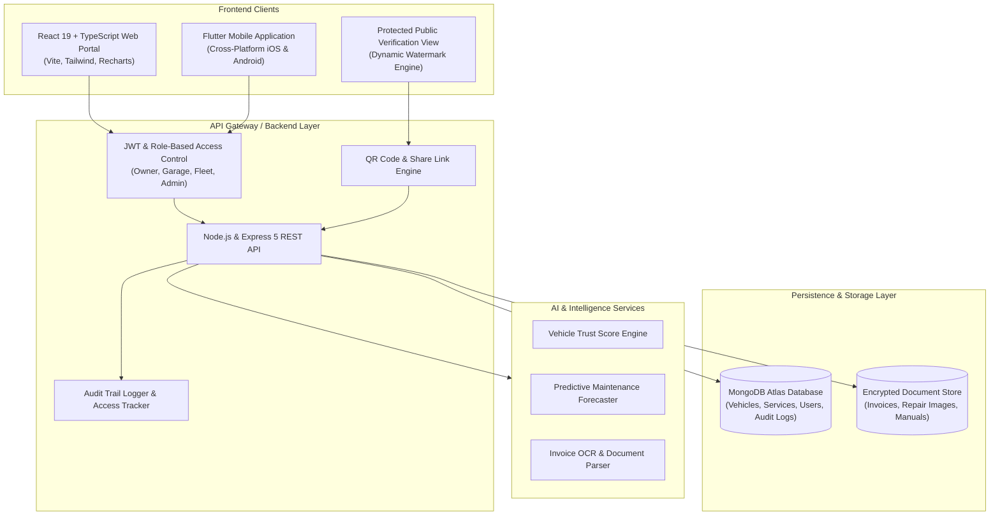

# AutoCare 360™ — Universal Vehicle Maintenance Record System

[](https://react.dev/)
[](https://nodejs.org/)
[](https://www.mongodb.com/)
[](LICENSE)
[](#)

> **Universal Digital Vehicle Maintenance Record Platform & Digital Vehicle Passport**  
> Replacing fragmented paper logs and untrusted service histories with an owner-controlled, tamper-resistant, AI-assisted digital maintenance ecosystem.

---

## 📋 Table of Contents

- [Executive Summary](#-executive-summary)
- [The Problem vs. The Solution](#-the-problem-vs-the-solution)
- [Target Stakeholders](#-target-stakeholders)
- [Core Features & Requirements](#-core-features--requirements)
- [System Architecture](#-system-architecture)
- [Security, Privacy & Anti-Fraud Engine](#-security-privacy--anti-fraud-engine)
- [Business Rules](#-business-rules)
- [Technology Stack](#-technology-stack)
- [Project Directory Structure](#-project-directory-structure)
- [Installation & Getting Started](#-installation--getting-started)
- [Environment Configuration](#-environment-configuration)
- [Future Roadmap](#-future-roadmap)

---

## 🎯 Executive Summary

In today's automotive landscape, vehicle maintenance records are predominantly captured on paper invoices, isolated garage workbenches, or disconnected spreadsheets. This fragmentation leads to:
- Disputed repair histories and lack of maintenance transparency.
- Pervasive odometer and service fraud in used vehicle transactions.
- Zero centralized ownership or verifiable history when vehicles change hands.

**AutoCare 360** establishes a unified, verifiable digital maintenance passport for every vehicle. Built with an owner-first philosophy, vehicle owners retain complete sovereignty over their vehicle data while granting cryptographically verifiable, time-limited, and watermarked access to garages, prospective buyers, fleet managers, and insurance inspectors.

---

## 🔄 The Problem vs. The Solution

| Challenge in Traditional Systems (AS-IS) | AutoCare 360 Solution (TO-BE) |
| :--- | :--- |
| **Paper-Based Invoices:** Lost receipts, faded thermal paper, missing maintenance logs. | **Digital Vehicle Passport:** Single cloud-backed lifetime maintenance record per VIN. |
| **Tampering & Fraud:** Unverified repairs, falsified odometer readings, undocumented accidents. | **Verified Garage Entries:** Only authorized, certified service centers can sign off on service entries. |
| **All-or-Nothing Sharing:** Exposing private customer invoices and personal costs to buyers. | **Granular Permissions:** Share full history, summary only, or select records with zero leaks. |
| **Unprotected PDFs & Screenshots:** Shared documents get saved, forwarded, and forged. | **Protected View Mode:** Dynamic watermarking (User ID, IP, Expiry, Timestamp) + view-only restrictions. |
| **Manual Guesswork on Maintenance:** Missed oil changes, unmonitored timing belts. | **AI-Powered Diagnostics:** Predictive maintenance alerts and algorithmic **Vehicle Trust Scores (0-100)**. |

---

## 👥 Target Stakeholders

1. **Vehicle Owners:** Manage vehicle passports, store warranties, receive predictive service notifications, and control data sharing.
2. **Automotive Garages & Service Centers:** Manage customer vehicles, log verified services and parts replacements, and generate digital estimates and invoices.
3. **Prospective Vehicle Buyers:** Verify authentic mileage, repair consistency, and trust scores before purchase via instant QR scans.
4. **Fleet Operators & Leasing Agencies:** Monitor multi-vehicle maintenance health, schedule bulk services, and minimize operational downtime.
5. **Insurance Companies & Inspectors:** Review verified repair documentation, validate claim assessments, and detect pre-existing damages.

---

## 🚀 Core Features & Requirements

Aligned with the **Business Requirements Document (BRD v1.0)** specifications:

### 1. 🛡️ Digital Vehicle Passport (`BR-01`, `FR-02`)
- Universal profile indexed by **Registration Number, VIN / Chassis Number, and Engine Number**.
- Complete specification tracking: Make, Model, Manufacturing Year, Vehicle Type, Fuel Type, and Current Mileage.
- Seamless digital record ownership transfer during vehicle sales.

### 2. 🔧 Comprehensive Service & Maintenance History (`BR-02`, `FR-03`)
- Chronological logs containing:
  - Service date and verified garage & technician credentials.
  - Maintenance category (Routine Service, Mechanical, Electrical, Body & Paint, Tires).
  - Itemized replaced parts with serial numbers and warranty terms.
  - Labor costs, parts costs, high-resolution repair photos, and attached invoice PDFs.

### 3. 🏪 Verified Garage Portal (`BR-03`, `FR-05`)
- Garage onboarding and certification verification.
- Rapid intake of customer vehicles by VIN lookup.
- Verified service record creation preventing retroactive tampering.
- Quotation and digital invoice generation.

### 4. 🔗 Granular Data Sharing & Dynamic QR (`BR-05`, `BR-06`, `FR-07`, `FR-08`)
- **Dynamic QR Code Generation:** Generate vehicle-specific QR codes for windshield display, buyer inspection, or garage handoff.
- **Expiring Secure Share Links:** Configurable lifespan (e.g., 1 hour, 24 hours, 7 days) with custom passcodes.
- **Granular Access Levels:**
  - *Full Access:* Complete maintenance log, invoices, costs, and documentation.
  - *Limited Access:* Service dates, garages, and verified mileage progression (costs redacted).
  - *Selective Access:* Custom filtering (e.g., Engine & Transmission repairs only; insurance claims hidden).

### 5. 🤖 AI Vehicle Health & Predictive Intelligence (`BR-09`, `FR-10`)
- **Vehicle Trust Score (0–100):** Algorithmic index calculated from service interval regularity, verified garage ratio, mileage progression integrity, and major accident records.
- **Predictive Maintenance:** Machine learning projections for upcoming fluid changes, brake wear, and component lifecycle warnings based on driving cadence.
- **Invoice OCR Parsing:** Smart ingestion of paper invoices and parts lists into structured data.

### 6. 📊 Analytics & Cost Intelligence (`OBJ-07`, `FR-09`)
- Real-time expense breakdowns by category (routine maintenance vs. repairs vs. wear-and-tear).
- Fleet maintenance spending trends, monthly burn rates, and projected yearly depreciation.

---

## 🏗️ System Architecture



---

## 🔒 Security, Privacy & Anti-Fraud Engine

| Security Layer | Implementation Details | BRD Reference |
| :--- | :--- | :--- |
| **Owner Sovereignty** | Records are owned solely by vehicle owners; third parties cannot inspect or amend records without explicit cryptographic authorization. | `BRULE-02`, `BRULE-05` |
| **Protected Viewing Mode** | View-only interface disabling print, download, right-click, screenshot hints, and text selection for shared public links. | `BR-07` |
| **Dynamic Watermarking** | Real-time overlay embedded across shared documents showing: `Recipient Name`, `Access ID`, `Client IP`, `Timestamp`, and `Expiry Date`. | `BR-07` |
| **Tamper-Evident Audit Trail** | Every profile access, link creation, QR scan, and record edit is immutably logged with timestamp, user agent, and IP coordinates. | `BR-08`, `BRULE-04` |
| **Service Authenticity Guard** | Maintenance records can only be marked as *Verified* by KYC-validated, authenticated service facilities. | `BRULE-01` |

---

## ⚖️ Business Rules

- **`BRULE-01`**: Only authenticated and verified garages can append official service entries to a vehicle passport.
- **`BRULE-02`**: Third-party entities (buyers, insurers, leasing agencies) can only inspect vehicle records upon explicit owner authorization.
- **`BRULE-03`**: All shared URLs and generated QR codes must enforce mandatory expiration dates and maximum view quotas.
- **`BRULE-04`**: Every modification, view request, and authorization change must generate a tamper-proof audit trail log.
- **`BRULE-05`**: Vehicle passport data belongs strictly to the vehicle's legal owner and transfers automatically upon validated ownership reassignment.

---

## 💻 Technology Stack

### **Frontend**
- **Framework:** React 19 with TypeScript
- **Build Tool:** Vite 8
- **Routing:** React Router DOM v7
- **UI & Icons:** Vanilla CSS / Lucide React
- **Data Visualization:** Recharts
- **QR Operations:** `qrcode.react`
- **HTTP Client:** Axios

### **Backend**
- **Runtime:** Node.js (v18+)
- **Server Framework:** Express 5
- **Database Engine:** MongoDB with Mongoose ODM
- **Authentication:** JSON Web Tokens (JWT) & `bcryptjs`
- **File & Media Handling:** Multer (with secure mime-type verification)
- **Utilities:** UUID v4, QRCode generation, Dotenv

---

## 📁 Project Directory Structure

```text
AutoCare-360/
├── Backend/
│   ├── src/
│   │   ├── config/
│   │   │   └── db.js            # MongoDB database connection configuration
│   │   ├── controllers/         # Business logic handlers (Auth, Vehicle, Service, Share)
│   │   ├── models/              # Mongoose schemas (User, Vehicle, ServiceRecord, ShareLink)
│   │   ├── routes/              # Express API route endpoints
│   │   ├── middlewares/         # JWT verification, Role guards, Multer upload
│   │   └── server.js            # Express application bootstrap & middleware setup
│   ├── .env.example             # Backend environment template
│   ├── package.json             # Backend dependencies & script definitions
│   └── nodemon.json             # Development live-reload configuration
│
├── Frontend/
│   ├── public/                  # Public assets, favicon, icons
│   ├── src/
│   │   ├── assets/              # Static media, hero images, SVG graphics
│   │   ├── components/          # Reusable UI components (Navbar, Sidebar, Cards, Watermark)
│   │   ├── pages/               # Application views (Dashboard, VehicleProfile, AddRecord, QRView)
│   │   ├── services/            # Axios API client integrations
│   │   ├── App.tsx              # Root application component & layout routing
│   │   ├── main.tsx             # React DOM entry point
│   │   └── index.css            # Global styling, tokens, and responsive utility classes
│   ├── .env.example             # Frontend environment template
│   ├── index.html               # Main HTML entry point
│   ├── package.json             # Frontend dependencies & scripts
│   ├── tsconfig.json            # TypeScript configuration
│   └── vite.config.ts           # Vite configuration
│
└── README.md                    # Root project documentation
```

---

## ⚙️ Installation & Getting Started

### Prerequisites
- [Node.js](https://nodejs.org/) (version 18 or higher recommended)
- [MongoDB](https://www.mongodb.com/) (local instance or MongoDB Atlas cluster connection string)
- [Git](https://git-scm.com/)

---

### Step 1: Clone the Repository
```bash
git clone https://github.com/Akila-Liyanage/AutoCare-360.git
cd AutoCare-360
```

---

### Step 2: Configure & Start the Backend Server

1. Navigate to the backend directory:
   ```bash
   cd Backend
   ```

2. Install dependencies:
   ```bash
   npm install
   ```

3. Configure environment variables:
   ```bash
   cp .env.example .env
   ```
   *(Ensure your `MONGO_URI`, `PORT`, and `JWT_SECRET` are properly configured in `.env`)*

4. Launch the backend in development mode:
   ```bash
   npm run dev
   ```
   *The backend will boot up at `http://localhost:5000`.*

---

### Step 3: Configure & Start the Frontend Application

1. Open a new terminal tab and navigate to the frontend directory:
   ```bash
   cd ../Frontend
   ```

2. Install dependencies:
   ```bash
   npm install
   ```

3. Configure environment variables:
   ```bash
   cp .env.example .env
   ```

4. Launch the Vite dev server:
   ```bash
   npm run dev
   ```
   *The client app will be accessible at `http://localhost:5173`.*

---

## 🔑 Environment Configuration

### Backend (`Backend/.env`)
```env
PORT=5000
MONGO_URI=mongodb+srv://<username>:<password>@cluster.mongodb.net/autocare360?retryWrites=true&w=majority
JWT_SECRET=your_super_secret_jwt_key_here
JWT_EXPIRES_IN=7d
CLIENT_URL=http://localhost:5173
```

### Frontend (`Frontend/.env`)
```env
VITE_API_BASE_URL=http://localhost:5000/api
```

---

## 🗺️ Future Roadmap

- [ ] **Cross-Platform Mobile App:** Flutter implementation for iOS and Android with offline-first caching.
- [ ] **Automated OCR Scanning:** Ingestion pipeline using Azure AI Document Intelligence / Microsoft Copilot for parts invoices.
- [ ] **Enterprise InsurTech Integrations:** Direct API endpoints for vehicle insurance underwriters and leasing fleet audits.
- [ ] **Decentralized Verification (Web3/DID):** Optional tamper-proof hash anchoring for lifetime vehicle service milestones.

---

## 📄 License & Attribution

This project is licensed under the **ISC License**.  
Based on the **AutoCare 360 Business Requirements Document (BRD v1.0)** prepared by SLT Business Analysis.

Developed with passion by **[Akila Liyanage](https://github.com/Akila-Liyanage)**.
